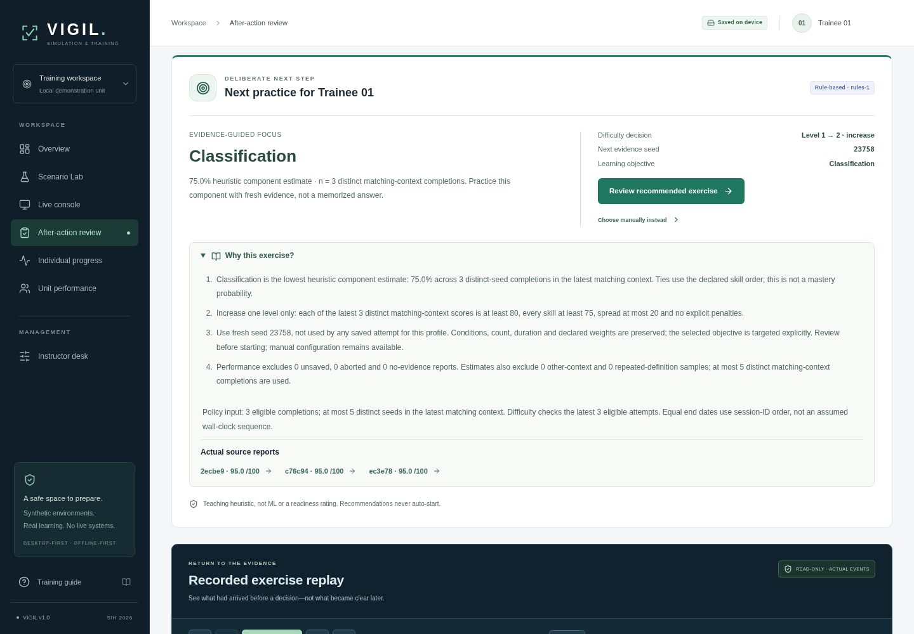

# VIGIL
### Adaptive Simulation & Training System

**SIH 2026 · PS 26247 project · Phase 6 verified local prototype / full working handoff**

Browser-first **synthetic observation, assessment and reporting training**: configure → brief → observe delivered evidence → assess/report → deterministic evaluation → actual-event replay/AAR → saved progress → **explainable rules-based next exercise → repeat**. No fabricated history, telemetry or model-performance claims. Official-brief conformance remains unverified: no authoritative attachment was available and the official portals returned 403.



*Actual production-browser QA capture, not initialized learner history or evidence of operational readiness. The planner is a transparent teaching heuristic, not ML.*

## Run the included ZIP without installing dependencies

**[Quick start](QUICK_START.md)** has the complete launch/backup instructions. Extract the whole archive, have Node **20.19+ or 22.12+ LTS** available, then:

```sh
node scripts/serve.mjs
```

Open **http://localhost:8787**. Windows can double-click `START-VIGIL.cmd`; macOS/Linux can run `sh start-vigil.sh`. Keep the terminal open. The ZIP includes the exact tested `dist/` production bundle and its module Worker. No `npm install`, account, API key, cloud service, Python backend, database server or special hardware is needed to run that bundle. `--port 8788` selects another port. Do not use `file://`.

The host binds `0.0.0.0` for preview compatibility; it is an unauthenticated local demonstration server, not a public production deployment. Use a trusted machine/network/firewall. Browser history is origin/profile-local: keep the same host/port/browser and take JSON backups.

## Develop / rebuild / test

```sh
npm ci
npm run dev
```

Vite prints the development address (normally 5173). Dependency/browser downloads need network on a fresh development machine; runtime code/assets/fonts are local. No paid API, secrets or external runtime services.

```sh
npm test                                # 369 unit/integration/component/protocol checks
npm run test:launcher                    # 9 native Node static-host checks
npm run build                           # strict TypeScript + production bundle
npx playwright install --with-deps chromium  # once; system packages may need admin
npm run preview -- --port 5173           # keep this production preview running
# In another terminal, with the intended production preview on 5173:
npm run test:e2e -- --workers=2           # 111 Chromium cases, 3 viewport sizes
npm audit
```

Playwright reuses the server on 5173 outside CI; its convenience fallback is development mode, **not** a production acceptance claim. The executed gate used the known rebuilt production preview. [Deployment / offline details](docs/DEPLOYMENT.md).

## Practice workflow

| Curated preset | Synthetic teaching conditions | Duration |
|---|---|---:|
| **Perimeter watch** | Rural daylight/clear, one independent return | 90s |
| **Urban ambiguity** | Urban dusk/haze, three crossing paths and schematic clutter | 120s |
| **Nightfall protocol** | Rural night/rain, four grouped paths and intermittent evidence | 150s |
| **Rural crossing** | Rural daylight/haze, two crossing paths and reporting focus | 120s |

Patterns are public teaching settings, not category answers or tactical swarm behavior. Validated custom settings remain available.

1. Select an anonymous profile. **Scenario Lab** offers manual presets/settings; **Review recommended exercise** offers the profile's history-based plan or a genuine Level 1 foundation. Reviewing a briefing starts no clock.
2. Explicit **Start exercise** configures the one authoritative module Worker. Select an actually delivered return → **Mark as tracked** → category/Unknown with confidence → measured training report. Requests schedule another attempt, not a guaranteed return.
3. Inspect capture/arrival/delay/age/source. Late old evidence cannot rewind a marker or refresh its age. Pause/resume and 1×/2×/4× affect pacing, not model values. Leaving the console pauses; backgrounding a running tab does not.
4. After termination inspect the fixed score, six components, explicit penalties, stored rubric/per-track audit and actual evidence links. Read-only replay folds the **recorded prefix**, including same-second event order, without regenerating/rescoring. Active/paused attempts lock current/prior answers, replay, private exports and planning.
5. Wait for **Saved on device** before reload. Actual completed **and aborted** reports, anonymous profiles and valid draft/selection persist. An interrupted live attempt produces no invented result. Aborted/no-evidence/unsaved reports remain reviewable but do not inform performance inference.
6. The AAR/overview **rules-1** panel explains target, sample/context/exclusions, actual source reports, held/changed level and fresh seed. Explicit review prepares another briefing, **never an automatic run**. Three consistent distinct matching-context completions are required before a one-level change. Manual choice remains available.
7. **Individual progress** separates heuristic competency estimates from all-history descriptive trends/components/comparisons. **Unit performance** uses real local attempt-weighted group/profile summaries. No data means `—`/n = 0, not seeded scores; teaching means are not normalized improvement or readiness.
8. **Instructor desk** provides JSON backup/import preview/confirmed atomic merge, formula-safe CSV and separately confirmed local-history reset. Each AAR offers JSON, self-contained HTML and browser print/PDF. Console reset does **not** erase saved history. Keep JSON backups before clearing/changing browser/site data.

Keyboard shortcuts outside form controls/buttons: **1–8** select, **T** track, **O** request observation, **Space** pause/resume. Normal Tab/Enter controls and scrollable data-table alternatives remain available.

## Implemented and executed

- Seven responsive screens, anonymous profiles/groups, explicit hydration/storage states, accessible navigation/guide/confirmations.
- Four curated/custom configurations with bounded conditions, pattern/count, reliability/noise/delay, uint32 seed, duration/difficulty, objectives/weights and helpful errors.
- **One authoritative Worker · schema 3 / generator-2 / sensor-2 / rubric-1 / replay-1.** Delivered-only active evidence, deterministic bounded evaluation and actual-event AAR/replay. No UI-created truth or alternative scorer.
- **IndexedDB v1 / portable format 1:** transaction-complete acknowledgements, serial writes, immutable-ID atomic merge/dedup, reset epochs, strict definition/evaluator/replay validation, quarantine/raw recovery, retained-report backup/retry.
- Actual saved descriptive progress and local unit means; actual JSON/CSV/HTML/print. Unsigned validation proves **consistency, not authenticity**.
- **Rules-1:** five nullable matching-context heuristic component estimates, actual source IDs/ranges, strict eligibility, conservative sparse/mixed/repeated/noisy holds, bounded one-level changes and saved-seed non-repeat. Healthy loaded Worker reuse supports an offline next-exercise cycle. [Exact policy](docs/ADAPTATION_SPEC.md).
- **Zero-dependency prebuilt launcher**, source/dependency lock/tests/docs, Windows/POSIX helpers and SHA-256 release inventory.

**Executed application gate:** **369/369** tests in 22 files, **9/9** launcher checks, strict production build, audit **0 vulnerabilities**, **111/111** production Chromium cases (37 journeys × 3 sizes, zero retries). All four presets and the next-practice two-exercise cycle work with network disabled after readiness. Actual scores/components/ordered events match Worker records; native-IDB/import/reset/failure/privacy/export/print regressions pass. **84 new Phase 6 captures**; 141 earlier captures preserved. [QA / remaining gaps](docs/QA_REPORT_PHASE_6.md) · [results and package verification](docs/TEST_RESULTS.md).

## Honest handoff boundary

The agreed **Phase 6 local browser core is implemented and verified**. Broader gates 7–8 are not blanket-certified by this handoff. The matrix has **27 Verified / 2 Partially implemented / 2 Missing** targets: official source evidence and optional VR remain missing; cross-browser/assistive-technology/performance breadth and real-event production/demo hardening remain partial.

Browser-local unsigned data is evictable and manually backed up. No accounts/trusted instructor role, cloud sync, automatic backup, legacy migration, active-run recovery, real-personnel database, PWA cold-start cache, validated ML, operational validity, production readiness or competition-ranking guarantee. Use synthetic identifiers only. [Limitations](docs/LIMITATIONS.md).

## Architecture / documents

React 19 + TypeScript + Vite, Zod, local CSS/SVGs. Worker owns live truth/evidence/actions/evaluation. Root owns route/briefing/guards; HistoryStore owns durable history/acknowledgements. Replay folds original events; adaptation reads existing saved evaluation credits without rescoring.

```text
src/domain/       shared validated/versioned contracts and public teaching rules
src/engine/       seeded hidden generator/sensor/clock/evidence/log
src/workers/      authoritative Runtime and module Worker
src/scoring/      one evaluator, declared rubric and actual-event audits
src/replay/       exact read-only recorded-prefix projection
src/persistence/  strict validation, native-IDB repository, serial HistoryStore
src/analytics/    actual descriptive summaries and portable/print exports
src/adaptive/     pure deterministic rules-1 saved-history policy
src/hooks/        Worker/playback/root guarded integration
src/components/   console/review/history/planning UI
src/pages/        overview, Lab, console, AAR, progress/unit/instructor
src/test/         actual-engine test fixtures, never initial app history
scripts/          no-dependency launcher, host tests, packaging/browser smoke tools
tests/e2e/        real-Worker/native-IDB browser journeys
docs/             specs, gates, QA, traceability, results and actual captures
```

- [Product](docs/PRODUCT_SPEC.md) · [Architecture](docs/ARCHITECTURE.md) · [Implementation gates](docs/IMPLEMENTATION_PLAN.md) · [Progress](docs/PROGRESS.md)
- [Scenario model](docs/SCENARIO_MODEL.md) · [Rubric](docs/SCORING_RUBRIC.md) · [Replay](docs/REPLAY_SPEC.md) · [Storage](docs/STORAGE_SPEC.md) · [Adaptation](docs/ADAPTATION_SPEC.md)
- [Phase 6 acceptance](docs/PHASE_6_PLAN.md) · [QA verdict](docs/QA_REPORT_PHASE_6.md) · [Every requirement/status/evidence](docs/REQUIREMENTS_TRACEABILITY.md)
- [Current results](docs/TEST_RESULTS.md) · [Archived Phase 5 results](docs/TEST_RESULTS_PHASE_5.md) · [Archived Phase 4 results](docs/TEST_RESULTS_PHASE_4.md)
- [Quick start](QUICK_START.md) · [Deployment/backup](docs/DEPLOYMENT.md) · [Limits](docs/LIMITATIONS.md)

**Safety:** fictional synthetic non-operational training only. No real target acquisition, weapons control, interception optimization or actionable engagement guidance.
